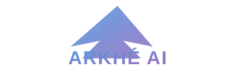

# IA na matemêƒÂ¡tica: 722 artigos e a diferenêƒÂ§a entre provar e entender

  
  
<strong>Arckhé AI</strong>

VêƒÂ­deo explicativo em portuguêƒÂªs (6m50s), com avatar e voz do Nei (ARCKHê‰): o que a OpenAI publicou em 6 de outubro de 2026, como o Lean confere uma prova, Riemann e Unique Games em linguagem simples, por que provar nêƒÂ£o êƒÂ© entender, o caso Navier-Stokes (acusa / nega), o risco para a criptografia e o que muda para quem usa IA no trabalho.

- YouTube: https://www.youtube.com/watch?v=pnKkO754pWU
- MP4 e legenda: na aba Releases (`video-v1.0.0`)
- Mais cursos e projetos abertos e gratuitos: https://ARCKHê‰ AI

---

  
  
<strong>Arckhé AI</strong>

